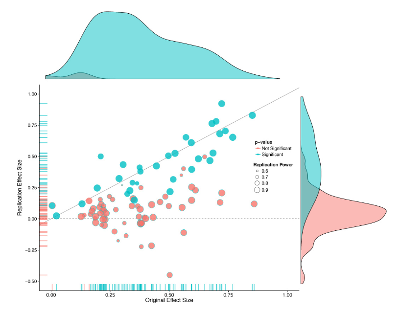
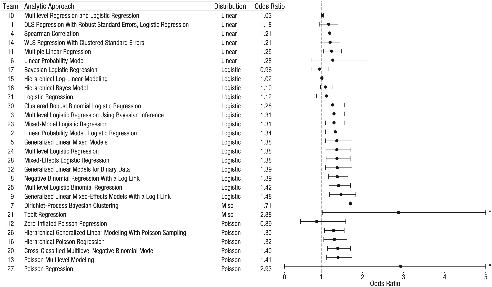
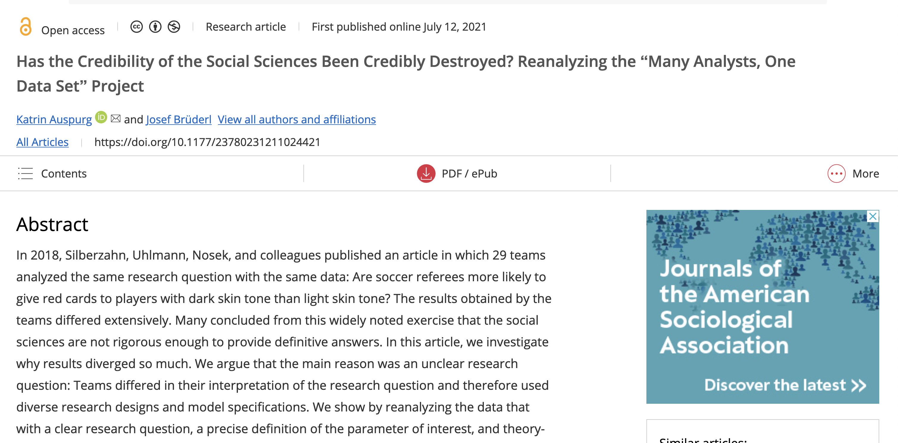
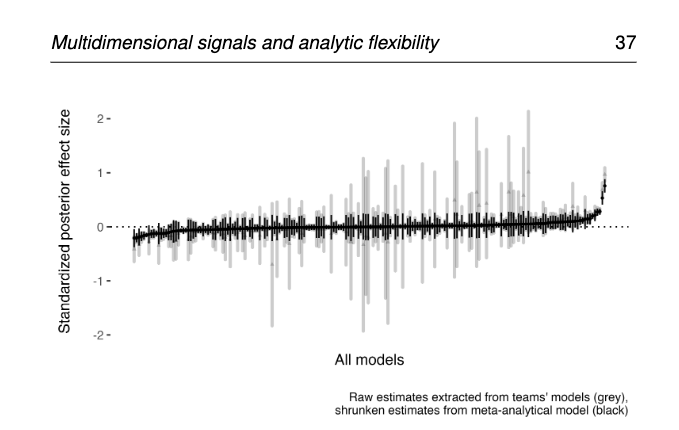
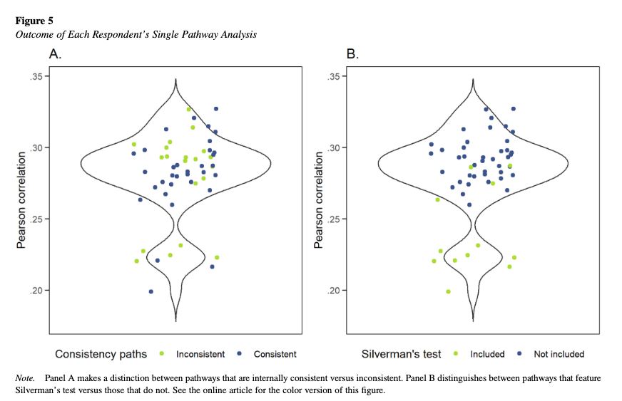
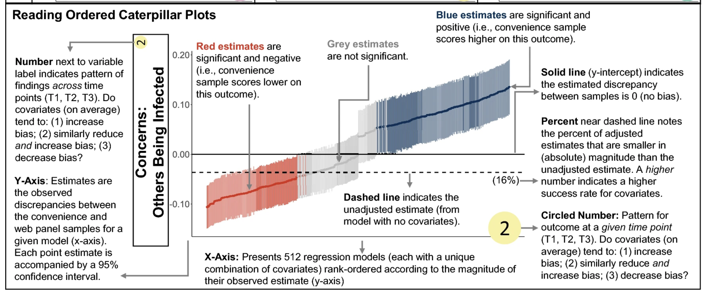

```{r}
#| include: false
library(tidyverse)
library(broom)
library(specr)
library(patchwork)
source("code/sim_toy.R")
theme_set(theme_minimal(base_size = 18))
```

## Outline {.smaller}

::: notes
Time plan for 90 minutes (not shown to the audience):

- 0-15: why a multiverse (motivation, many analysts, fit with open science)
- 15-35: building one (finding decisions, defensible options, deciding the summary in advance)
- 35-65: Demo 1, toy data from scratch
- 65-80: Demo 2, `specr` and `multiverse`
- 80-90: reporting, pitfalls, takeaways, questions

The technical notes at the end are backup for questions.
:::

- Why: researcher degrees of freedom, many analysts, and where a multiverse fits next to preregistration
- Build: finding decisions and defining a *defensible* multiverse
- Demo 1: toy data, from scratch in tidyverse
- Demo 2: the same thing with `specr` (and a look at `multiverse`)
- Reporting, pitfalls, and questions

## Learning goals {.smaller}

By the end you can:

- Name the decisions in your own analysis that could plausibly go another way
- Build a multiverse that is principled and not just a pile of every option
- Summarize using a specification curve, a choice plot, and say *which decisions matter*
- Interpret robustness, and say what a multiverse cannot tell you
- Report one alongside a preregistration

# Why a multiverse?

::: notes
About 15 minutes. Spend the most time on the many-analysts studies; they are the hook. Keep the open-science table short.
:::

## Where this started {.smaller}

- The Open Science Collaboration (2015) replicated 100 psychology studies, and a lot of attention went to *how* results get produced and reported.
- In replication, it seemed clear that the analysis (and methodology!) itself is full of choices.



## Same data, different answers {.smaller}

- Raw data turn into results through many steps:
  - Exclusions, scoring, transformations, covariates, model, inference criteria.
  - We also have to remember that methodological choices also influence outcomes!
- Each step of a cleaning and/or analysis pipeline has several reasonable options.
  - *Researcher degrees of freedom* (Simmons, Nelson, & Simonsohn, 2011)
  - *Garden of forking paths* (Gelman & Loken, 2014)
- Reporting only one path hides how much the answer depends on that choice.

## Silberzahn et al. (2018) {.smaller}

- 29 teams, one dataset, one question: do referees give more red cards to darker-skin players?
- Estimates ranged from slightly negative to strongly positive, and about two-thirds of teams found a significant effect.
- The spread comes from *reasonable* decisions.



## Auspurg & Brüderl (2021) {.smaller}

- A reanalysis of the same project, and they decided that the divergence came from an *unclear research question*, because teams interpreted it differently.
- A multiverse only helps if the question is pinned down first.

{fig-align="center" width="85%"}

## Coretta et al. (2023) {.smaller}

- The same kind of analytic flexibility in speech-science analyses.
- Others to check out:
  - Botvinik-Nezer et al. (2020) in neuroimaging
  - Schweinsberg et al. (2021) in a crowdsourced hypothesis test.



## Steegen et al. (2016): {.smaller}

- Their focus was the *data* multiverse where one raw dataset becomes many processed datasets, one per reasonable combination of processing choices (exclusions, coding, cut-offs).
- A *model* multiverse does the same for the statistical analysis choices.
- The goal is transparency by showing how much the conclusion depends on the choices.

Steps:

1.  List the defensible choices at each step.
2.  Run every combination.\*
3.  Look at the *distribution* of results, not one number.

\* Combinations may not make sense - see note later!

## Related approaches {.smaller}

The same logic shows up under different names, with different emphases:

- *Specification curve analysis* (Simonsohn et al., 2020): focuses on plotting every reasonable specification in rank order and testing whether the whole set of results is inconsistent with a null effect.
- *Vibration of effects* (Patel et al., 2015): focuses on how much an estimate changes as you vary the model, for example, the covariates you adjust for.
- *Many analysts* (Silberzahn et al., 2018): the same idea, but with different people making the choices instead of one researcher listing them.

In practice the labels overlap, and people use the terms loosely. What matters is that you report the whole set of results, not one path.

## Where it fits next to open science {.smaller}

| Tool | Answers |
|----|----|
| Preregistration | What did I commit to *before* seeing the data? |
| Registered report | Has the plan been peer reviewed *before* data collection, with acceptance in principle? |
| Multiverse | How much does the conclusion depend on my choices? |

- A multiverse complements preregistration. Preregistration gives you one confirmatory test; the multiverse is a transparent *sensitivity analysis* around it.
- You can preregister the multiverse itself.
- It is not a license to go fishing as the decision set must be defined by reasons, not by results.

# Building a multiverse

::: notes
About 20 minutes (minutes 15-35). Stress that the options must be defensible and the summary decided in advance. Ask the room for forks in their own work.
:::

## Step 1: find the decisions {.smaller}

Walk through the pipeline and ask "could a reasonable colleague do this differently?"

| Stage | Example forks |
|----|----|
| Sample | exclusion criteria, such as attention checks, speeders, and age |
| Outliers | none, ±3 SD, ±2 SD, or winsorizing |
| Measures | full scale, short form, or subscale; mean or sum |
| Transformations | raw, log, or z-score |
| Model | covariates, interactions, linear or mixed model |
| Inference | α level, one- or two-tailed, frequentist or Bayesian |

Tip: good sources for forks are papers you review, your own old scripts, and your lab's disagreements.

## Finding decisions, step by step {.smaller}

Heyman et al. (2025):

1.  Pin down the research question.
2.  Collect pathways from the literature and from experts.
3.  Combine them into one tree of options.
4.  Have others validate the tree and prune what doesn't belong.

## Finding decisions, step by step {.smaller}



## Step 2: keep it *defensible* {.smaller}

For each option, ask:

- Is there a substantive or statistical reason it could be right?
- Would a reviewer accept it in a paper?
- Is it equivalent in kind to the others, such as answering the same question?

Drop options that are known to be wrong (e.g., a model that ignores nested data when it is clearly nested).

## Step 3: pre-register the plan {.smaller}

Before running anything, write down:

- The primary specification (usually your preregistered one)
- What counts as "robust" (e.g. ≥ 80% of specifications in the same direction? median effect above a smallest effect of interest?)
- How you will summarize (curve, share significant, variance by decision)

# Demo 1: toy data

::: notes
About 30 minutes (minutes 35-65). Walk through the code slowly, then spend the time on the plots: spec curve, which decisions matter, and the null simulation. If you are running behind, skip the variance slide.
:::

Step 4: do the thing!

## The study {.smaller}

A simulated experiment: does a brief gratitude exercise (`treat`) raise well-being?

- n = 300, randomized, 8 well-being items (`wb1`-`wb8`)
- Some careless responders (`attn_ok = 0`) who add noise
- Survey time in minutes, age, gender

Two worlds, same code:

- World A: a small true effect (d = 0.25)
- World B: no effect (d = 0)

Question for the multiverse: *can we tell the worlds apart, and how often would a single path mislead us?*

## Simulate the data {.smaller}

```{r}
world_a <- sim_toy(d = 0.25, seed = 11)
world_b <- sim_toy(d = 0,    seed = 22)
glimpse(world_a)
```

*A custom function to generate the data `sim_toy` included in materials.*

## The decisions {.smaller}

```{r}
decisions <- expand_grid(
  exclusion  = c("none", "attention", "speeders", "both"),
  outliers   = c("none", "3sd", "2sd"),
  dv         = c("full_mean", "short_mean", "first_item"),
  covariates = c("none", "age", "age_gender")
)
nrow(decisions)
```

4 × 3 × 3 × 3 = 108 specifications.

## Why those options? {.smaller}

- Exclusion: attention check failures; completion under 4 minutes ("speeders"); both
- Outliers: none, ±3 SD, ±2 SD on the outcome
- DV: all 8 items, a 5-item short form, a single item
- Covariates: none, age, age + gender
- *Note:* this plan is a bit of a data multiverse and a bit of a analysis multiverse

## One function per decision: exclusions {.smaller}

```{r}
apply_exclusion <- function(dat, exclusion) {
  switch(exclusion,
    none      = dat,
    attention = filter(dat, attn_ok == 1),
    speeders  = filter(dat, minutes >= 4),
    both      = filter(dat, attn_ok == 1, minutes >= 4))
}
```

*For interested folks, each line of code is explained at the end of this slide deck*.

## One function per decision: scoring {.smaller}

```{r}
score_dv <- function(dat, dv) {
  dat |>
    mutate(y = switch(dv,
      full_mean  = rowMeans(across(wb1:wb8)),
      short_mean = rowMeans(across(wb1:wb5)),
      first_item = wb1))
}
```

## One function per decision: outliers {.smaller}

```{r}
drop_outliers <- function(dat, outliers) {
  k <- switch(outliers, none = Inf, `3sd` = 3, `2sd` = 2)
  filter(dat, abs(scale(y)[, 1]) <= k)
}
```

## One function per decision: model {.smaller}

```{r}
fit_model <- function(dat, covariates) {
  rhs <- switch(covariates,
    none = "treat", age = "treat + age", age_gender = "treat + age + gender")
  m <- lm(as.formula(paste("y ~", rhs)), data = dat)
  sd_y <- sd(dat$y)
  tidy(m, conf.int = TRUE) |>
    filter(term == "treat") |>
    transmute(estimate, std_estimate = estimate / sd_y,
              conf.low, conf.high, p.value, n = nrow(dat))
}
```

## Put them together: one specification {.smaller}

```{r}
fit_spec <- function(dat, exclusion, outliers, dv, covariates) {
  dat |>
    apply_exclusion(exclusion) |>
    score_dv(dv) |>
    drop_outliers(outliers) |>
    fit_model(covariates)
}
fit_spec(world_a, "both", "3sd", "full_mean", "age")
```

## Run the multiverse {.smaller}

```{r}
run_multiverse <- function(dat) {
  decisions |>
    mutate(res = pmap(list(exclusion, outliers, dv, covariates),
                      \(e, o, d, c) fit_spec(dat, e, o, d, c))) |>
    unnest(res)
}
mv_a <- run_multiverse(world_a)
mv_b <- run_multiverse(world_b)
```

## Peek at the results {.smaller}

```{r}
mv_a |> select(exclusion:covariates, std_estimate, p.value, n) |> head(5)
```

## First summary {.smaller}

```{r}
summarise_mv <- function(mv) mv |>
  summarise(
    n_specs        = n(),
    median_effect  = median(std_estimate),
    range          = paste0(round(min(std_estimate), 2), " to ", round(max(std_estimate), 2)),
    pct_p_lt_05    = round(100 * mean(p.value < .05)),
    pct_positive   = round(100 * mean(std_estimate > 0)))
bind_rows(`World A (d = .25)` = summarise_mv(mv_a),
          `World B (d = 0)`   = summarise_mv(mv_b), .id = "world")
```

*Standardized estimates are in SD units of the outcome in each specification \~ d.*

## How to read an ordered plot {.smaller}

- Each point is one specification, sorted by effect size, with its confidence interval.

- Color marks significant vs. not

- The dashed line is the baseline estimate.

{fig-align="center" width="95%"}

## Specification curve: the plot function {.smaller}

```{r}
curve_plot <- function(mv, title) {
  mv <- mv |> arrange(std_estimate) |> mutate(rank = row_number(),
                                              sig = p.value < .05)
  ggplot(mv, aes(rank, std_estimate, colour = sig)) +
    geom_hline(yintercept = 0, linetype = 2) +
    geom_pointrange(aes(ymin = conf.low / (estimate / std_estimate),
                        ymax = conf.high / (estimate / std_estimate)),
                    size = .2, alpha = .7) +
    scale_colour_manual(values = c(`FALSE` = "grey60", `TRUE` = "#c0392b"),
                        labels = c("p ≥ .05", "p < .05"), name = NULL) +
    labs(title = title, x = "Specification (ranked)", y = "Standardized effect") +
    theme(legend.position = "bottom")
}
```

## Specification curve: World A {.smaller}

```{r}
#| fig-width: 11
#| fig-height: 6
curve_plot(mv_a, "World A: true effect")
```

- Notice that some of the same "effect size" would be considered \~0 versus \> 0.

## Same plot, null world {.smaller}

```{r}
#| fig-width: 11
#| fig-height: 6
curve_plot(mv_b, "World B: no true effect")
```

- With no true effect, the estimates scatter around zero, and some are positive and some negative.

- The curve helps you see that no single path is "the" answer.

## Which decisions matter? Reshape {.smaller}

```{r}
overall <- mean(mv_a$std_estimate)

mv_long <- mv_a |>
  pivot_longer(exclusion:covariates, names_to = "decision", values_to = "option") |>
  mutate(key = paste(decision, option, sep = "___")) |>
  group_by(key) |>
  mutate(option_mean = mean(std_estimate)) |>
  ungroup() |>
  mutate(key = fct_reorder(key, option_mean))
```

Each specification now appears four times, once for each decision, tagged with the option it used.

## Which decisions matter? Build the plot {.smaller}

```{r}
#| fig-show: hide
choice_plot <- ggplot(mv_long, aes(std_estimate, key)) +
  geom_vline(xintercept = overall, linetype = 2, colour = "grey50") +
  geom_jitter(height = .15, alpha = .35, colour = "grey40", size = 1.8) +
  stat_summary(fun = mean, geom = "point", colour = "#c0392b", size = 4) +
  facet_wrap(~ decision, ncol = 2, scales = "free_y") +
  scale_y_discrete(labels = \(x) sub("^.*___", "", x)) +
  labs(x = "Standardized effect (grey = one specification, red = mean)", y = NULL)
```

## Which decisions matter? The plot {.smaller}

```{r}
#| echo: false
#| fig-width: 11
#| fig-height: 6.5
choice_plot
```

- If an option moves the whole cloud, that decision matters.

- Here, which participants are excluded shifts the estimates most.

## How much variance does each decision explain? {.smaller}

```{r}
vc <- function(mv) {
  fit <- lm(std_estimate ~ exclusion + outliers + dv + covariates, data = mv)
  a <- anova(fit)
  tibble(decision = rownames(a), pct = 100 * a[["Sum Sq"]] / sum(a[["Sum Sq"]])) |>
    mutate(pct = round(pct, 1))
}
vc(mv_a)
```

- Who gets excluded drives most of the variation

- Then outcome definition; covariates barely matter.

- Gives you a value for the previous slide's visual.

## Type I Error in Action {.smaller}

What if we report only the best path? Simulate 200 studies with no effect and run the full multiverse on each (`code/null_sim.R`):

```{r}
null_sim <- readRDS("code/null_sim.rds")
null_sim |>
  summarise(`single pre-specified path, p < .05` = mean(first_sig),
            `best of 108 paths, p < .05`         = mean(any_sig),
            `typical share of paths p < .05`     = mean(pct_sig)) |>
  mutate(across(everything(), \(x) scales::percent(x, accuracy = 1)))
```

- Choosing the best path after the fact gives a "significant" result in roughly a third of null studies.
- A multiverse is descriptive: it shows how much a result depends on choices.
- It does not say which path is right and it does not rescue a weak design.

# Demo 2: packages

::: notes
About 15 minutes (minutes 65-80). `specr` first, then `multiverse`. Finish on the "which tool when" table.
:::

## `specr`: prepare the data {.smaller}

```{r}
d_sr <- world_a |>
  mutate(wb_full  = rowMeans(across(wb1:wb8)),
         wb_short = rowMeans(across(wb1:wb5)),
         wb_item1 = wb1)
```

`specr` expects each choice to be a variable, so the outcome definitions become columns.

## `specr`: declare the choices {.smaller}

```{r}
specs <- setup(
  data     = d_sr,
  x        = "treat",
  y        = c("wb_full", "wb_short", "wb_item1"),
  model    = "lm",
  controls = c("age", "gender"),
  subsets  = list(attn_ok = 0:1))
```

- `y`: the outcome definitions
- `controls`: the covariates to cross
- `subsets`: groups of participants to analyze separately, here the attention check

## `specr`: run it {.smaller}

```{r}
res <- specr(specs)
```

- Choices must be variables (outcomes, predictors, controls) or subsets.

- Decisions like outlier rules do not fit that mold, so we run `specr` once per rule (after the plots), which is why Demo 1 was by hand.

## `specr` output: curve and choices {.smaller}

```{r}
#| fig-width: 11
#| fig-height: 7
plot(res, choices = c("y", "controls", "subsets"))
```

## `specr` summary {.smaller}

```{r}
summary(res)
```

## `specr` variance {.smaller}

```{r}
#| fig-width: 9
#| fig-height: 3.5
plot(res, type = "variance")
```

## `specr`: outlier rules mean one run per rule {.smaller}

`specr` has no slot for outlier rules, because a rule changes which rows are kept. The workaround is to run `specr` once for each outlier rule and stack the results.

```{r}
outlier_rules <- c(none = Inf, `3sd` = 3, `2sd` = 2)

res_by_rule <- imap(outlier_rules, \(k, label) {
  d_k <- d_sr |>
    mutate(across(c(wb_full, wb_short, wb_item1),
                  \(v) if_else(abs(scale(v)[, 1]) <= k, v, NA_real_)))
  specr(setup(data = d_k, x = "treat",
              y = c("wb_full", "wb_short", "wb_item1"),
              model = "lm", controls = c("age", "gender"),
              subsets = list(attn_ok = 0:1))) |>
    as_tibble() |>
    mutate(outliers = label)
}) |>
  list_rbind()
```

## `specr`: the stacked results {.smaller}

```{r}
res_by_rule |>
  group_by(outliers) |>
  summarise(n_specs = n(), median_estimate = median(estimate),
            pct_p_lt_05 = round(100 * mean(p.value < .05)))
```

Three runs of 36 specifications each give 108 in total. Outlier values are set to missing, not dropped, so `lm()` leaves those rows out for that outcome only, which matches screening each outcome separately.

## `multiverse`: the idea {.smaller}

The `multiverse` package (Sarma, Kay, and colleagues) lets you declare alternatives *inside* your analysis code in an R Markdown document, using `branch()` for each decision.

- Good for rich pipelines and parallel runs.
- Steeper learning curve than `specr`.

## `multiverse`: declare the data branches {.smaller}

```{r}
library(multiverse)
M <- multiverse()

inside(M, {
  df <- world_a |>
    filter(branch(exclusion,
      "none"      ~ TRUE,
      "attention" ~ attn_ok == 1,
      "speeders"  ~ minutes >= 4,
      "both"      ~ attn_ok == 1 & minutes >= 4)) |>
    mutate(y = branch(dv,
      "full_mean"  ~ rowMeans(across(wb1:wb8)),
      "short_mean" ~ rowMeans(across(wb1:wb5)),
      "first_item" ~ wb1)) |>
    filter(abs(scale(y)[, 1]) <= branch(outliers,
      "none" ~ Inf,
      "3sd"  ~ 3,
      "2sd"  ~ 2))
})
```

## `multiverse`: declare the model branches {.smaller}

```{r}
inside(M, {
  rhs <- branch(covariates,
    "none"       ~ "treat",
    "age"        ~ "treat + age",
    "age_gender" ~ "treat + age + gender")
  m <- lm(as.formula(paste("y ~", rhs)), data = df)
  res <- tidy(m, conf.int = TRUE) |>
    filter(term == "treat") |>
    transmute(estimate, std_estimate = estimate / sd(df$y),
              conf.low, conf.high, p.value, n = nrow(df))
})
```

Same four decisions as Demo 1, now declared inside the analysis code.

## `multiverse`: run it and list the universes {.smaller}

```{r}
execute_multiverse(M)
expand(M) |> select(.universe, exclusion, outliers, dv, covariates)
```

Each row is one universe: 4 × 3 × 3 × 3 = 108.

## `multiverse`: the results {.smaller}

```{r}
mv_pkg <- expand(M) |>
  mutate(res = map(.results, "res")) |>
  unnest(res)
mv_pkg |> select(exclusion:covariates, std_estimate, p.value, n)
```

The estimates sit in a `.results` column, and we pull them out ourselves.

## `multiverse`: does it match Demo 1? {.smaller}

```{r}
mv_a |>
  inner_join(mv_pkg, by = c("exclusion", "outliers", "dv", "covariates"),
             suffix = c("_by_hand", "_pkg")) |>
  summarise(n_matched = n(),
            max_abs_difference = max(abs(std_estimate_by_hand - std_estimate_pkg)))
```

The same 108 specifications give the same estimates, so the package and the by-hand code are two routes to one multiverse.

## `multiverse`: the specification curve {.smaller}

```{r}
#| fig-width: 11
#| fig-height: 6
curve_plot(mv_pkg, "multiverse package: all 108 universes")
```

The package gives you the table of universes and results; the plot is ours, from Demo 1.

## Which tool when? {.smaller}

|   | by hand | `specr` | `multiverse` |
|----|----|----|----|
| Best for | full control, teaching | quick spec curves | long pipelines, reporting |
| Data-processing forks | yes | limited | yes |
| Built-in plots | write your own | yes | partly |
| Learning curve | low code, more typing | lowest | highest |

# Reporting and pitfalls

::: notes
About 10 minutes (minutes 80-90), including questions. If time is short, go straight to takeaways and leave the pitfalls slide for questions.
:::

## What to report {.smaller}

- The full decision table and the reason for each option
- The primary specification, flagged
- A specification curve and a "which decisions matter" display
- A one-line robustness statement, e.g. *"The effect was positive in all 108 specifications (median d = X, range X to X), and p \< .05 in X%."* (fill in from your own results)
- Code and data, so others can add branches

## Pitfalls {.smaller}

- Too many bad branches: inflates fragility.
- Too few branches: inflates robustness.
- Branches chosen after seeing results: back to forking paths.
- Treating specifications as independent: they share the same data, so "67% significant" is not a replication rate.
- Ignoring the design: a multiverse cannot fix confounding or low power.
- Cherry-picking the summary: don't *p*-hack!

## Takeaways {.smaller}

1.  Many analytic choices are defensible; the answer may depend on them.
2.  A multiverse maps that dependence rather than hiding it.
3.  Define options for *reasons*, decide the summary in advance, and report the whole distribution.
4.  It complements preregistration; it does not replace it.

## Resources {.smaller}

- Steegen et al. (2016), *Perspectives on Psychological Science*: the original multiverse paper
- Simonsohn, et al. (2020), *Nature Human Behaviour*: specification curve analysis
- Silberzahn et al. (2018), *AMPPS*: many analysts
- Heyman et al. (2025), *Psychological Methods*: crowdsourcing multiverse pathways (tutorial)
- Dragicevic et al. (2019); Liu et al. (2021): `boba` for large multiverses
- R packages: `specr`, `multiverse`

Questions?

# Technical notes {background-color="#f4f4f4"}

Line-by-line explanations of the code, for anyone who wants to dig in.

## Notes: `sim_toy()`, participants {.smaller}

``` r
sim_toy <- function(n = 300, d = 0.25, seed = 1) {
  set.seed(seed)
  tibble(
    id      = 1:n,
    treat   = rep(0:1, length.out = n),
    age     = round(rnorm(n, 35, 11)),
    gender  = sample(c("woman", "man", "nonbinary"), n, replace = TRUE,
                     prob = c(.5, .45, .05)),
    minutes = rlnorm(n, log(8), .5),
    attn_ok = ...   # next slide
  )
```

- `n`, `d`, `seed`: sample size, true treatment effect in SD units, and a seed so each world is reproducible.
- `treat`: alternates 0, 1, 0, 1, so groups are balanced.
- `age`: normal with mean 35 and SD 11, rounded to whole years.
- `gender`: sampled with the given probabilities.
- `minutes`: log-normal, so it is right-skewed with a median of about 8 minutes.

## Notes: `sim_toy()`, the attention check {.smaller}

``` r
attn_ok = rbinom(n, 1, plogis(.5 + .15 * scale(minutes)[, 1]) * .95 + .02)
```

Read it from the inside out:

- `scale(minutes)[, 1]`: z-scores survey time, so 0 is an average respondent and 1 is one SD slower. The `[, 1]` turns the one-column result into a plain vector.
- `.5 + .15 * ...`: a baseline of .5 plus .15 for each SD of survey time. This is on the logit scale, where numbers can be any size.
- `plogis(...)`: converts the logit to a probability between 0 and 1. A logit of .5 is a probability of about .62.
- `* .95 + .02`: squeezes the probability into the range .02 to .97, so nobody is certain to pass or certain to fail.
- `rbinom(n, 1, ...)`: for each person, flips a weighted coin with that probability. 1 means they pass the attention check.
- Overall, about 6 in 10 people pass, and slower respondents are more likely to.

## Notes: `sim_toy()`, outcomes {.smaller}

``` r
  |> mutate(
    latent   = rnorm(n) + d * treat + .01 * (age - 35),
    noise_sd = if_else(attn_ok == 1, .8, 2.2),
    wb1 = latent + rnorm(n, 0, noise_sd),
    # ... wb2 to wb5 are the same
    wb6 = .5 * latent + rnorm(n, 0, noise_sd + .5),
    # ... wb7 and wb8 are the same
  ) |>
  select(-latent, -noise_sd)
```

- `latent`: each person's true well-being: random variation, plus `d` for the treated group, plus a small age effect.
- `noise_sd`: careless responders get a much larger noise SD (2.2 instead of .8), so their answers carry little signal.
- `wb1` to `wb5`: the latent score plus noise.
- `wb6` to `wb8`: weaker items. They load half as strongly on the latent score and get extra noise.
- `select(-latent, -noise_sd)`: drops the hidden variables, so the data look like real survey data.

## Notes: the decision grid {.smaller}

``` r
decisions <- expand_grid(
  exclusion  = c("none", "attention", "speeders", "both"),
  outliers   = c("none", "3sd", "2sd"),
  dv         = c("full_mean", "short_mean", "first_item"),
  covariates = c("none", "age", "age_gender")
)
nrow(decisions)
```

- `expand_grid()` builds one row for every combination of the options you give it.
- Each column is one decision, and each row is one specification, so 4 × 3 × 3 × 3 gives 108 rows.
- Adding an option, or a whole new decision, changes the number of rows automatically.
- Everything downstream reads this table, so it is also the record of what you decided to include.

## Notes: exclusions and scoring {.smaller}

``` r
apply_exclusion <- function(dat, exclusion) {
  switch(exclusion,
    none      = dat,
    attention = filter(dat, attn_ok == 1),
    speeders  = filter(dat, minutes >= 4),
    both      = filter(dat, attn_ok == 1, minutes >= 4))
}

score_dv <- function(dat, dv) {
  dat |>
    mutate(y = switch(dv,
      full_mean  = rowMeans(across(wb1:wb8)),
      short_mean = rowMeans(across(wb1:wb5)),
      first_item = wb1))
}
```

- `switch()` picks the branch whose name matches the text it is given, so "speeders" runs the `speeders` line.
- `filter()` keeps rows that meet the condition. Listing two conditions requires both.
- `across(wb1:wb8)` selects those eight columns, and `rowMeans()` averages across them for each person.
- The result goes into a new column, `y`, so every later step uses the same name no matter which outcome definition was chosen.

## Notes: outliers {.smaller}

``` r
drop_outliers <- function(dat, outliers) {
  k <- switch(outliers, none = Inf, `3sd` = 3, `2sd` = 2)
  filter(dat, abs(scale(y)[, 1]) <= k)
}
```

- `k` is the cut-off in SD units. `Inf` for "none" means nothing is ever dropped.
- `scale(y)` z-scores the outcome. It returns a one-column matrix, and `[, 1]` turns it into a plain vector.
- `abs(...) <= k` keeps people within `k` SDs of the mean in either direction.
- Backticks around `3sd` are needed because a name starting with a digit is not a valid R name.
- This runs after scoring, because the outcome `y` has to exist before it can be screened.

## Notes: the model {.smaller}

``` r
fit_model <- function(dat, covariates) {
  rhs <- switch(covariates,
    none = "treat", age = "treat + age", age_gender = "treat + age + gender")
  m <- lm(as.formula(paste("y ~", rhs)), data = dat)
  sd_y <- sd(dat$y)
  tidy(m, conf.int = TRUE) |>
    filter(term == "treat") |>
    transmute(estimate, std_estimate = estimate / sd_y,
              conf.low, conf.high, p.value, n = nrow(dat))
}
```

- `rhs` is the right-hand side of the model formula, written as text. `paste()` and `as.formula()` turn the text into a real formula.
- `lm()` fits the regression, and `tidy(m, conf.int = TRUE)` returns the coefficients as a table with confidence intervals.
- `filter(term == "treat")` keeps only the treatment effect, ignoring covariates and the intercept.
- `std_estimate` divides the raw estimate by the SD of the outcome, so effects from different outcome definitions are on a comparable scale. It is a standardized difference, not exactly Cohen's d.
- `n = nrow(dat)` records how many people were left after exclusions, which varies across specifications.

## Notes: one specification {.smaller}

``` r
fit_spec <- function(dat, exclusion, outliers, dv, covariates) {
  dat |>
    apply_exclusion(exclusion) |>
    score_dv(dv) |>
    drop_outliers(outliers) |>
    fit_model(covariates)
}
```

- The pipe `|>` passes the data through the steps in order: exclude, score, drop outliers, then model.
- Each step is one of the small functions from the previous slides, so the function reads like a recipe.
- Changing that order is itself a decision you could vary.
- The result is a one-row table for that combination of choices.

## Notes: all specifications {.smaller}

``` r
run_multiverse <- function(dat) {
  decisions |>
    mutate(res = pmap(list(exclusion, outliers, dv, covariates),
                      \(e, o, d, c) fit_spec(dat, e, o, d, c))) |>
    unnest(res)
}
```

- `pmap()` goes through the four decision columns together, one row at a time.
- `\(e, o, d, c) ...` is a short anonymous function: it takes one row's four choices and calls `fit_spec()`.
- Each call returns a one-row table, so `res` is a column of tables, and `unnest(res)` spreads them into ordinary columns next to the decisions.
- The result has 108 rows, one per specification.

## Notes: the summary table {.smaller}

``` r
summarise_mv <- function(mv) mv |>
  summarise(
    n_specs       = n(),
    median_effect = median(std_estimate),
    range         = paste0(round(min(std_estimate), 2), " to ",
                           round(max(std_estimate), 2)),
    pct_p_lt_05   = round(100 * mean(p.value < .05)),
    pct_positive  = round(100 * mean(std_estimate > 0)))

bind_rows(`World A (d = .25)` = summarise_mv(mv_a),
          `World B (d = 0)`   = summarise_mv(mv_b), .id = "world")
```

- `summarise()` collapses all 108 rows into one row of summary statistics.
- `mean(p.value < .05)` is the proportion of specifications that are significant, because a true or false test averages to a proportion. Multiplying by 100 gives a percentage.
- `paste0()` glues the smallest and largest estimates into a single "min to max" label.
- `bind_rows()` stacks the two worlds' summaries. Because the arguments are named, `.id = "world"` turns those names into a column.

## Notes: the specification curve {.smaller}

``` r
curve_plot <- function(mv, title) {
  mv <- mv |> arrange(std_estimate) |>
    mutate(rank = row_number(), sig = p.value < .05)
  ggplot(mv, aes(rank, std_estimate, colour = sig)) +
    geom_hline(yintercept = 0, linetype = 2) +
    geom_pointrange(aes(ymin = conf.low / (estimate / std_estimate),
                        ymax = conf.high / (estimate / std_estimate)),
                    size = .2, alpha = .7) +
    scale_colour_manual(values = c(`FALSE` = "grey60", `TRUE` = "#c0392b"),
                        labels = c("p ≥ .05", "p < .05"), name = NULL) +
    labs(title = title, x = "Specification (ranked)", y = "Standardized effect") +
    theme(legend.position = "bottom")
}
```

- `arrange()` sorts from the smallest to the largest effect, and `row_number()` turns that order into the x-axis rank.
- `sig` marks each specification as significant or not, and drives the colour.
- `geom_hline(yintercept = 0)` draws the no-effect line as a reference.
- `estimate / std_estimate` equals the outcome SD in that specification. Dividing the raw confidence limits by it puts them on the same standardized scale as the points.
- `scale_colour_manual()` fixes grey for non-significant and red for significant.

## Notes: which decisions matter {.smaller}

``` r
mv_long <- mv_a |>
  pivot_longer(exclusion:covariates, names_to = "decision", values_to = "option") |>
  mutate(key = paste(decision, option, sep = "___")) |>
  group_by(key) |>
  mutate(option_mean = mean(std_estimate)) |>
  ungroup() |>
  mutate(key = fct_reorder(key, option_mean))

geom_jitter(height = .15, alpha = .35)
stat_summary(fun = mean, geom = "point", colour = "#c0392b", size = 4)
```

- `pivot_longer()` stacks the four decision columns into two: which decision, and which option was chosen. Each specification then appears four times.
- `key` joins the decision and the option, because option names such as "none" repeat across decisions. `fct_reorder()` sorts the keys by their mean effect so each panel reads from low to high.
- `geom_jitter()` draws one grey dot per specification, nudged vertically so they do not pile up. The spread shows how much results vary within an option.
- `stat_summary(fun = mean)` adds the red mean for each option.
- `facet_wrap(..., scales = "free_y")` gives each decision its own panel with its own options, and `scale_y_discrete(labels = ...)` strips the decision name back off the labels.

## Notes: variance by decision {.smaller}

``` r
vc <- function(mv) {
  fit <- lm(std_estimate ~ exclusion + outliers + dv + covariates, data = mv)
  a <- anova(fit)
  tibble(decision = rownames(a), pct = 100 * a[["Sum Sq"]] / sum(a[["Sum Sq"]])) |>
    mutate(pct = round(pct, 1))
}
```

- `vc()` regresses the estimates on the four decisions, using the specifications as the data.
- `anova()` splits the variation in the estimates into a sum of squares per decision. Dividing each by the total gives the percent of variation that decision explains.
- `Residuals` is whatever the decisions do not explain, mostly their interactions.

## Notes: Type I error in action {.smaller}

``` r
null_sim <- map_dfr(1:200, \(i) {
  mv <- decisions |>
    mutate(res = pmap(list(exclusion, outliers, dv, covariates),
                      \(e, o, d, c) fit_spec(sim_toy(d = 0, seed = 1000 + i), e, o, d, c))) |>
    unnest(res)
  tibble(i, any_sig = any(mv$p.value < .05), pct_sig = mean(mv$p.value < .05),
         first_sig = mv$p.value[1] < .05)
})
```

- `map_dfr(1:200, ...)` repeats the function 200 times and stacks the results into one table.
- `sim_toy(d = 0, seed = 1000 + i)` simulates a new null study each time, with a different but reproducible seed.
- Each study runs through all 108 specifications, using the same functions as the deck.
- `first_sig` is whether the first specification (no exclusions, no outlier rule, full scale, no covariates) was significant, which stands in for one pre-specified path.
- `any_sig` is whether at least one of the 108 was significant, which is what picking the best path would give you.
- `pct_sig` is the share of the 108 that were significant in that study. The saved result lives in `code/null_sim.rds`, so the deck does not have to rerun it.

## Notes: `specr` {.smaller}

``` r
specs <- setup(
  data     = d_sr,
  x        = "treat",
  y        = c("wb_full", "wb_short", "wb_item1"),
  model    = "lm",
  controls = c("age", "gender"),
  subsets  = list(attn_ok = 0:1))
res <- specr(specs)
```

- `x` is the predictor of interest, and `y` lists the outcome columns to try. Each becomes its own branch of the multiverse.
- `controls` are the covariates. `specr` crosses every combination, including none, which is why we list the variables and not the combinations.
- `subsets` runs the analysis separately within each level of a variable. Here `attn_ok = 0:1` runs it on everyone, then on the groups defined by the attention check.
- `specr(specs)` fits every model and collects the results into one object.

## Notes: `specr` plots {.smaller}

``` r
plot(res, choices = c("y", "controls", "subsets"))
plot(res, type = "variance")
```

- The first `plot()` draws the ranked curve on top and a panel of dots below showing which choices went into each specification.
- `type = "variance"` shows how much of the variation in the estimates each choice accounts for, like our `vc()` table.

## Notes: `specr` by outlier rule {.smaller}

``` r
imap(outlier_rules, \(k, label) {
  d_k <- d_sr |> mutate(across(..., \(v) if_else(abs(scale(v)[, 1]) <= k, v, NA_real_)))
  specr(setup(data = d_k, ...)) |> as_tibble() |> mutate(outliers = label)
}) |> list_rbind()
```

- `outlier_rules` is a named vector of cut-offs, and `imap()` loops over it, giving the loop both the value `k` and its name `label`.
- Inside the loop, `scale(v)[, 1]` z-scores each outcome, and `if_else()` keeps the value if it is within `k` SDs and sets it to `NA` otherwise.
- Setting values to `NA` instead of dropping rows lets all three outcomes share one data frame, and `lm()` removes the missing rows on its own for each model.
- `as_tibble()` turns the `specr` object into a table of results, one row per specification, and `mutate(outliers = label)` records which rule produced it.
- `list_rbind()` stacks the three tables into one.

## Notes: `multiverse`, declaring branches {.smaller}

``` r
M <- multiverse()
inside(M, {
  filter(branch(exclusion, "none" ~ TRUE, "attention" ~ attn_ok == 1))
  filter(abs(scale(y)[, 1]) <= branch(outliers, "none" ~ Inf, "3sd" ~ 3))
})
```

- `multiverse()` creates an empty multiverse object, `M`.
- `inside(M, {...})` holds your analysis code. You can call it more than once, and the code accumulates in order, so we declared the data steps first and the model steps second.
- `branch(name, "option" ~ code, ...)` declares one decision. The name (`exclusion`) becomes a column, and each option is a label tied to the code it runs.
- Because the right side of `~` is just code, branches can hold filters, scoring rules, or cut-off numbers.
- `abs(scale(y)[, 1]) <= branch(outliers, ...)` shows a branch used inside a larger expression, here to set the cut-off. `Inf` keeps everyone.
- The model formula is built from text, as in Demo 1, because `~` inside `branch()` is reserved for labelling options.

## Notes: `multiverse`, running and extracting {.smaller}

``` r
execute_multiverse(M)
expand(M)

mv_pkg <- expand(M) |>
  mutate(res = map(.results, "res")) |>
  unnest(res)
```

- `execute_multiverse(M)` runs the code for every combination of branches and saves what each universe created.
- `expand(M)` returns one row per universe: the branch choices, plus a `.results` column holding the objects each universe created, such as `res`.
- `map(.results, "res")` pulls the saved `res` out of each universe.
- `unnest(res)` turns those one-row tables into ordinary columns next to the branch choices.
- The result is one row per universe, so 108 here, ready for the same summaries and plots as Demo 1.
